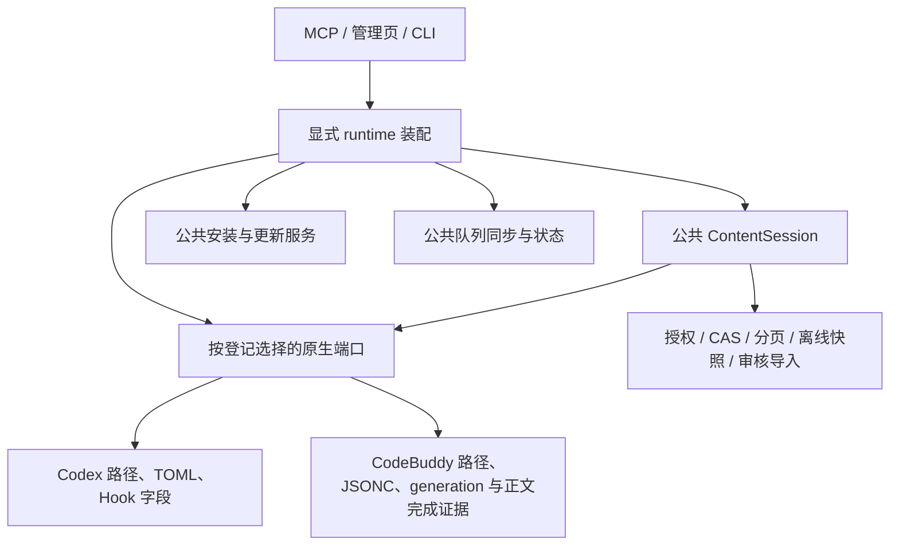

# Harness 公共能力与原生边界

本轮以 Client 0.8.9 `17954a0` 为整改基线。功能对等按同一业务合同验收；文件数量不作为依据。用户的真实宿主验收保持暂停，源码测试不证明模型已加载新文件。

## 依赖方向

`ContentSession` 必须显式提供 `NativeContentHost`；公共服务没有默认原生映射器。原生文件事务和恢复由 `storage.native_mapping` 管理，原生内容提供器仅负责路径、格式与来源读取。审核、导入、撤销审核、CAS 关联和对账在 `storage.source_imports` 中实现。

安装入口必须显式传入 `harness`；共享安装服务不根据目录名猜测宿主。原生引导入口在调用公共命令时传入其宿主选项。安装、受信渠道、固定解释器、启动器交接和恢复位于 `adapters.installation`。`RegisteredClientInstallation` 必须注入宿主维护端口；`runtime.host_maintenance` 根据已登记的宿主组合更新，不自动安装另一宿主或恢复暂停状态。`runtime.client_lifecycle` 从已认证的登记命令或卸载前像选择内容端口，再调用公共生命周期服务。

原生适配器不互相导入。旧源码模块已移动，没有旧模块转发入口。原登记文件名、Server adapter 身份、受信渠道以及已经持久化的队列摘要属于数据合同，不能随 Python 目录重命名。它们不决定运行哪种原生适配器。保留／重装读取原投影账本的精确绑定，不执行旧运行代码，也不把旧队列改绑到新身份。

## 对等范围

| 业务 | 两端实现与验证边界 |
|---|---|
| MCP 查询、CAS 写入、回执、离线读取 | 同一公共会话；同一业务向量分别注入两种原生端口。|
| 云端 Rule / Skill 原生加载 | Codex 写原有 AGENTS 块和 `.agents/skills`；CodeBuddy 写 `.codebuddy/rules` 和 `.codebuddy/skills`；启停、依赖白名单、冲突、目录所有权和回滚共用事务。|
| 手动队列同步 | 遍历两种已持久化来源队列，使用原请求与原绑定；一端损坏不阻断另一端，整体结果据实报告 incomplete。|
| 状态 | 区分原生 MCP、采集入口、共享服务暂停与队列；原生送达和模型采用仍为未观测。|
| 原生 Memory 迁入 | 各自提供路径无关的来源 ID 和指纹；公共审核后才能准备导入；不以会话历史扫描代替持久 Memory。|
| 项目入口 | 显式 `--harness`，项目设置和 CodeBuddy 项目队列隔离；共用来源授权、召回、暂停、同步和项目链接；原生项目 Hook 格式留各自适配层。|
| 安装、更新、代码快照与恢复 | 公共实现通过已登记宿主端口操作；CodeBuddy-only 回归禁止导入 Codex，另有公共安装与内容测试同时禁止两个具体宿主包。|
| 双宿主卸载与重装 | 卸载先检查每个投影的未确认写入；重装分别保留账本、原生 surface、Hook 暂停和项目停止状态；旧队列归档保留，不改绑重放。|

Codex 项目设置保留原目录摘要；CodeBuddy 项目使用独立前缀及项目队列。已存在的单宿主 schema-1 项目数据按其原合同识别，刷新时写入明确宿主。多宿主重装把停止状态保留为各宿主独立的本地 fence；显式 project enable 只解除本项目、本宿主的 fence。

项目任务的 schema-1 `codex-project` 判别值和 Server 的既有 `codex-project` 来源模式是持久化／协议字段；实际原生解析器由项目设置中的 `harness` 显式选择，不能由这些历史名称推断宿主。

## CodeBuddy 宿主证据

- [CLI Skills](https://www.codebuddy.cn/docs/cli/skills)：用户级 `.codebuddy/skills` 和项目级 Skills；`SKILL.md` 的 name / description。
- [IDE Skills](https://www.codebuddy.cn/docs/ide/Features/Skills)：项目 Skills 和用户 Skills 管理；原生加载仍需按宿主正常方式观察。
- [CLI Memory / Rules](https://www.codebuddy.cn/docs/cli/memory)：`CODEBUDDY.md`、Auto Memory 的 `memories/{project-id}` 与 `memories/global`、规则 `enabled` / `alwaysApply` / `paths`。CLI 不支持 IDE 的模型智能选取规则；按需 Rule 保留原生文件和可读索引，不扩大为始终加载正文。
- [IDE Rules](https://www.codebuddy.cn/docs/ide/User-guide/Rules)：始终、智能体请求、手动三类；已有会话不会自动加载修改后的规则。
- [IDE Memory](https://www.codebuddy.cn/docs/ide/User-guide/Memory)：原生持久记忆是独立能力，不等同于未来会话采集。

2026-11-12 只读核对本机 CodeBuddy IDE **4.12.1**、内置 `genie` 扩展 **3.10.0**：用户 Rule 根为用户 home 下的 `.codebuddy/rules`，读取 `.md/.mdc`；IDE Memory 根为 `CodeBuddyExtension/Data/Public/.memories`，读取 `.md/.mdc`。Mac 在 `Library/Application Support` 下，Windows 在 `AppData/Local` 下。这里只读取应用安装代码，未读取用户 Memory 或会话数据。核对的扩展 bundle SHA-256 为 `3254b5b4c4efe82f8e6b44ee3c5205524a0d250b667b85464d6485c4189f5c26`。

IDE 的原生 Memory 路径不是公开版本化 API；其他 IDE 版本应核对来源契约并以明确 unavailable / incomplete 状态报告，不能猜测其他目录或扩大扫描范围。CLI 智能选取 Rule 的差异有官方文档依据；“已写入原生文件”不代表宿主当前模型已采用。

## 回归依据

`tests/test_harness_parity.py` 覆盖双宿主 CAS、原队列幂等、离线快照、Rule/Skill 映射和来源审核；CodeBuddy-only 子进程禁止导入整个 Codex 适配器包，并检查不会创建 `.codex` 或 `.agents`。原安装、卸载、暂停、恢复及历史队列字节回归仍需通过完整检查后才可发布。
